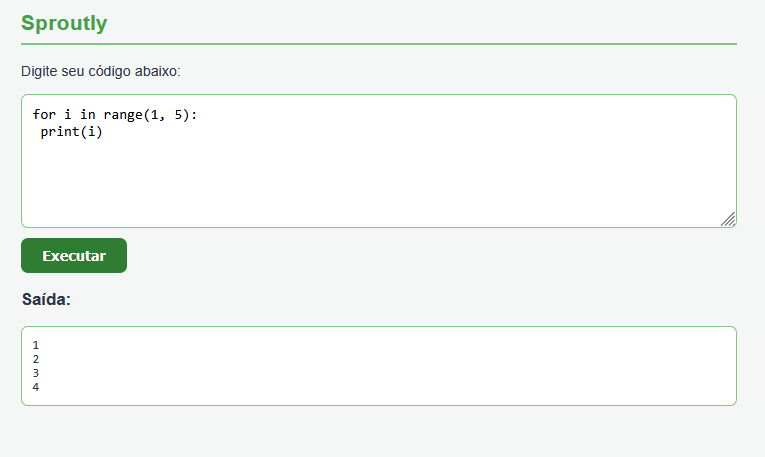

<h1 align="center">🌱 Sproutly</h1>

<p align="center">
  <strong>Aprenda Python rodando código de verdade, direto no navegador.</strong>
</p>

<p align="center">
  
  
  
  
</p>

---

## 🌿 Sobre o projeto

O **Sproutly** é uma plataforma web de ensino de programação, inspirada em juízes online, com foco em **Python** e em uma experiência mais **intuitiva para quem está começando**.

Ele nasceu da minha experiência como bolsista do **PET Computação UFC**, dando aulas de programação para alunos de escolas públicas. A ideia é simples: o aluno escreve o código, clica em rodar e vê o resultado na hora, **sem instalar nada**.

## ✅ O que já funciona

- Editor para escrever código Python
- Botão **Rodar**, que executa o código direto no navegador com o [Pyodide](https://pyodide.org) (Python compilado para WebAssembly), sem precisar de servidor
- Saída do programa (`print`) exibida na tela
- Mensagens de erro mostradas ao usuário
- Aviso quando o editor está vazio

<!-- Adicione aqui um print da tela, por exemplo:

-->

## 🌱 Próximos passos

Ideias para as próximas versões:

- [ ] Enunciados de problemas para o aluno resolver
- [ ] Correção automática com casos de teste, como nos juízes online
- [ ] Suporte a entrada de dados (`input`)
- [ ] Trilhas progressivas de exercícios para iniciantes
- [ ] Mensagens de erro mais amigáveis e em português

## 🛠️ Tecnologias

- HTML
- JavaScript
- [Pyodide](https://pyodide.org)

## ▶️ Como rodar

```bash
git clone https://github.com/mangoistired/projeto-Sproutly.git
cd projeto-Sproutly
python3 -m http.server 8000
```

Depois, abra `http://localhost:8000` no navegador. Na primeira vez, o Pyodide pode levar alguns segundos para carregar; quando aparecer **"Pronto!"**, é só escrever seu código e clicar em **Rodar**.

## 📁 Estrutura

```
projeto-Sproutly/
├── index.html    # página e editor
├── script.js     # carrega o Pyodide e executa o código
└── package.json
```

## 👤 Autor

**Max Rodrigues Santos**
Estudante de Ciência da Computação na UFC e bolsista do PET Computação.

[github.com/mangoistired](https://github.com/mangoistired)
